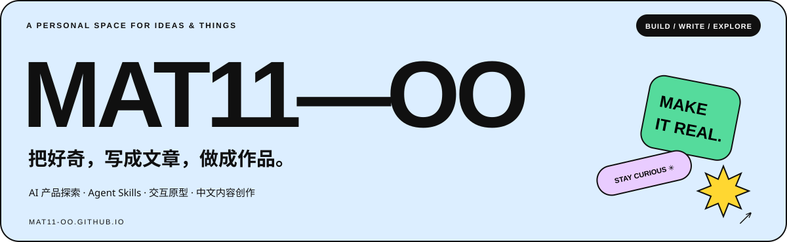
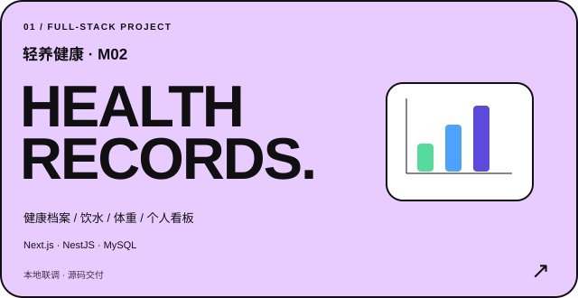
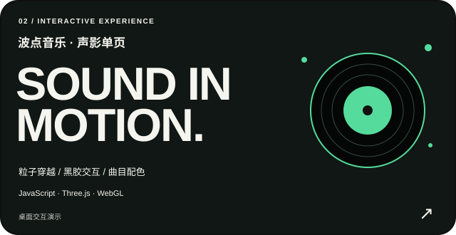
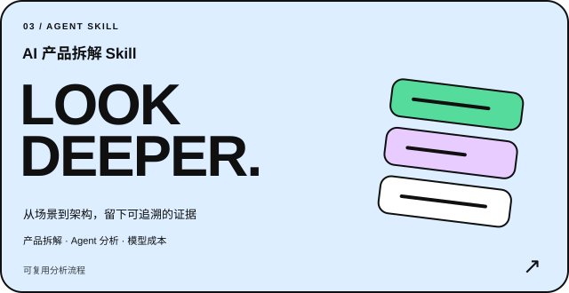
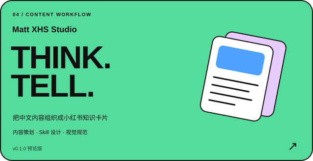
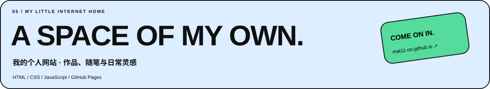

  

  <a href="https://mat11-oo.github.io/">🌐 个人网站  ↗</a> ·
  <a href="#projects">🧩 全部项目</a> ·
  <a href="#skills">📌技能与标签</a> ·
  <a href="#writing">✍️ 我的文章</a>

## 你好，我是 Mat11-oo 👋

我在探索 AI 产品、Agent Skills 和内容创作，也会用 AI 协作开发，把想法做成能体验的原型。

这里放我的项目和文章：既记录做出了什么，也记录实现过程、判断依据，以及还需要验证的部分。

**我的标签**　`AI 产品探索`　`Agent Skills`　`交互原型`　`Agent 工作流
`　`公开构建`

## 🧩 全部项目

<table>
<tr>
<td width="50%" valign="top">

### 轻养健康 · M02

围绕健康档案、饮水与体重记录，连接前端页面、后端接口和 MySQL 数据，再汇总成今日看板与个人健康大屏。

`TypeScript` `Next.js` `NestJS` `MySQL`

[源码与启动说明](https://github.com/Mat11-oo/qingyang-health-m02) · [接口文档](https://github.com/Mat11-oo/qingyang-health-m02/blob/main/docs/M02/API_GUIDE.md)

本地联调与公开源码交付；团队生产接入仍待装配。

</td>
<td width="50%" valign="top">

### 波点音乐 · 声影单页

用粒子空间、黑胶唱片、试听和全站曲目配色，探索音乐产品的沉浸式网页表达。

`JavaScript` `Three.js` `WebGL` `Canvas`

[在线体验 ↗](https://mat11-oo.github.io/bodian-music-showcase/) · [源码与实现](https://github.com/Mat11-oo/bodian-music-showcase)

桌面优先的产品展示与交互演示。

</td>
</tr>
<tr>
<td width="50%" valign="top">

### AI 产品拆解 Skill

从真实场景体验出发，拆解用户链路、人机分工、Agent 与模型成本，把分析过程整理成可复用流程。

`产品分析` `Agent 分析` `场景评测` `Skill 设计`

[源码与使用方法](https://github.com/Mat11-oo/ai-product-teardown) · [证据与评测规范](https://github.com/Mat11-oo/ai-product-teardown/blob/main/references/evidence-and-evaluation.md)

区分页面事实、合理推断与尚未确认的内容。

</td>
<td width="50%" valign="top">

### Matt XHS Studio

把内容策划、知识卡片的设计规范、样图确认与发布文案，整理成面向小红书图文的创作 Skill。

`内容策划` `知识卡片` `提示词` `创作工作流`

[项目入口](https://github.com/Mat11-oo/matt-xhs-studio) · [使用指南](https://github.com/Mat11-oo/matt-xhs-studio/blob/main/docs/guide.md)

v0.1.0 预览版；图像能力依赖宿主，成品效果尚未完成验证。

</td>
</tr>
</table>

### 我的个人网站

把作品、想法和文章放在自己的线上空间。采用贴纸拼贴与超大字体设计，使用 GitHub Actions 自动发布。

`HTML` `CSS` `JavaScript` `GitHub Pages`

[打开网站 ↗](https://mat11-oo.github.io/) · [查看源码](https://github.com/Mat11-oo/mat11-oo.github.io)

<strong>查看完整仓库目录</strong>

| 仓库 | 内容 |
| --- | --- |
| [qingyang-health-m02](https://github.com/Mat11-oo/qingyang-health-m02) | 健康记录与个人看板，前后端源码 |
| [bodian-music-showcase](https://github.com/Mat11-oo/bodian-music-showcase) | 沉浸式音乐展示与交互 |
| [ai-product-teardown](https://github.com/Mat11-oo/ai-product-teardown) | AI 产品拆解与评测 Skill |
| [matt-xhs-studio](https://github.com/Mat11-oo/matt-xhs-studio) | 小红书图文创作 Skill |
| [mat11-oo.github.io](https://github.com/Mat11-oo/mat11-oo.github.io) | 个人网站 |
| [Mat11-oo](https://github.com/Mat11-oo/Mat11-oo) | 当前 GitHub 个人主页、项目封面与文章索引 |

[浏览全部公开仓库 ↗](https://github.com/Mat11-oo?tab=repositories)

## 🛠 技能与实践方向

| 方向 | 我在项目中实践的内容 | 对应作品 |
| --- | --- | --- |
| **AI 产品分析** | 场景拆解、人机分工、Agent 架构、模型成本与证据判断 | [AI 产品拆解](https://github.com/Mat11-oo/ai-product-teardown) |
| **Skill 与工作流设计** | 触发边界、提示词、模板、交付与验收规则 | [产品拆解 Skill](https://github.com/Mat11-oo/ai-product-teardown) · [XHS Studio](https://github.com/Mat11-oo/matt-xhs-studio) |
| **AI 协作开发** | 页面与交互原型、前后端接口、数据记录与部署 | [轻养健康](https://github.com/Mat11-oo/qingyang-health-m02) · [波点音乐](https://github.com/Mat11-oo/bodian-music-showcase) |
| **中文内容创作** | 长文观察、内容策划、知识卡片的信息组织与视觉规范 | [文章索引](./ARTICLES.md) · [XHS Studio](https://github.com/Mat11-oo/matt-xhs-studio) |

**项目中用到的技术与工具**

`TypeScript` `JavaScript` `React` `Next.js` `NestJS` `MySQL` `Three.js` `WebGL` `Git` `GitHub Actions` `Codex`

## ✍️ 文章与知识记录

<table>
<tr>
<td width="180" align="center">

</td>
<td valign="top">

### 在微信公众号读我的文章

用微信扫描二维码，进入我的公众号。

公众号原始 ID：`gh_0a0e80b7d682`

[查看文章索引](./ARTICLES.md) · [打开完整二维码](./assets/wechat-account-qr.jpg)

</td>
</tr>
</table>

### 文章

- [当 ChatGPT 和 Codex 要在一个钱包里花钱了：AI 时代的精细化过冬](https://mp.weixin.qq.com/s/R56d-aIISFxM5_NYPZd66w) · AI 工具与使用成本
- [AI 四巨头，突然开始讲武德了](https://mp.weixin.qq.com/s/iU-H9b4l1zz94Wy8IZ-3CA)
- [花 1000 亿买下“看门大爷”：OpenAI 的金主盯上了你家大门口](https://mp.weixin.qq.com/s/Xy8u5FnnJ-aeGzPuL8l0Iw)

[查看文章索引 ↗](./ARTICLES.md)

### 实践文档

- [AI 产品拆解：七阶段分析流程](https://github.com/Mat11-oo/ai-product-teardown/blob/main/SKILL.md)
- [健康记录项目：接口调用与团队接入](https://github.com/Mat11-oo/qingyang-health-m02/blob/main/docs/M02/API_GUIDE.md)
- [小红书图文 Skill：使用方法与创作流程](https://github.com/Mat11-oo/matt-xhs-studio/blob/main/docs/guide.md)

---

  <strong>保持好奇，动手去做，把过程写下来。</strong> 
  BUILD SMALL · THINK CLEARLY · KEEP WRITING  
  <a href="https://mat11-oo.github.io/">个人网站</a> · <a href="https://github.com/Mat11-oo?tab=repositories">开源项目</a>

